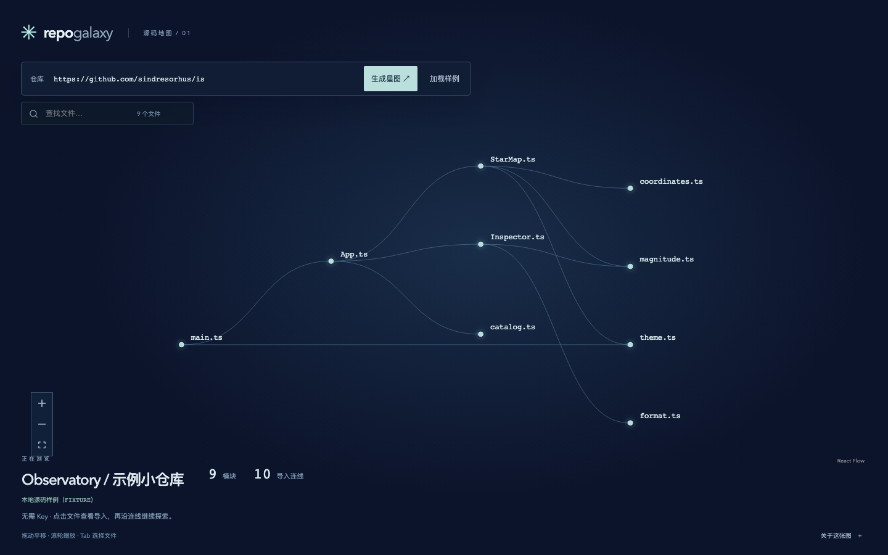
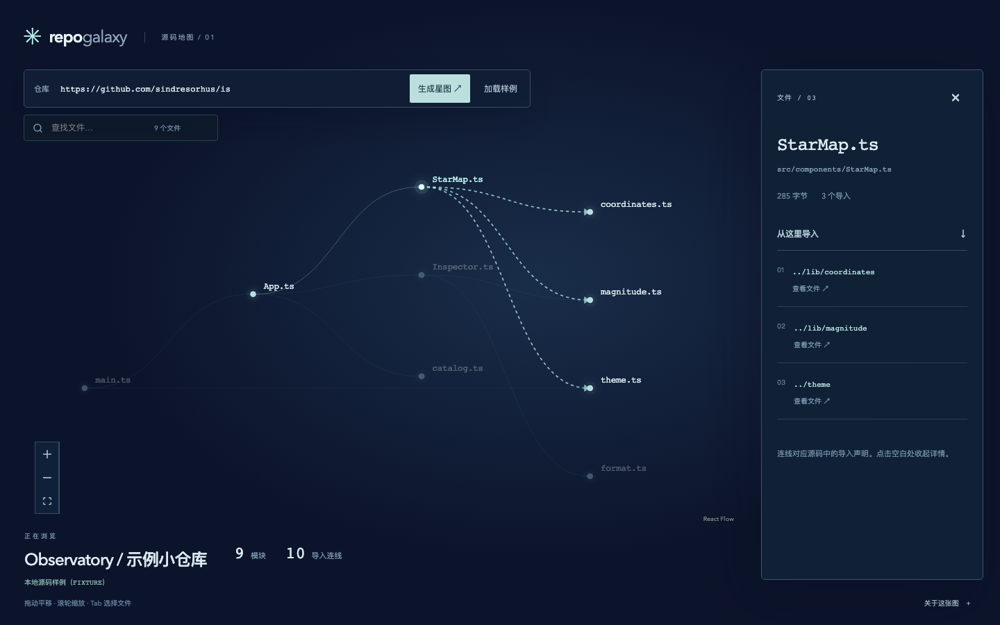

# RepoGalaxy · 代码星图

**接手一个陌生仓库，先看文件之间的路。**

打开项目，目录里有几十个文件。入口找到了，可它又依赖谁？
RepoGalaxy 把 TypeScript / JavaScript 的导入关系画成一张能点的图。搜索一个文件，展开它的导入，再顺着连线走到下一个模块。



### 适合第一次读这个项目的你

读代码时，图谱可以当一张导航图：先找到关注的文件，再沿着依赖逐个看。讲解小项目时，也能直接指着连线说明模块怎样组合。

| 你想知道 | 在星图里怎么找 |
| --- | --- |
| 入口依赖了哪些文件？ | 搜索入口，点击节点查看导入列表 |
| 这个组件在哪里？ | 输入文件名，定位到图上的模块 |
| 下一步该读哪个文件？ | 点击详情中的相对导入，跳到目标模块 |

不需要模型或 API Key。连线来自源码解析，每条都有对应的导入声明。

### 在本机打开

准备 **Node.js 24 LTS** 与 npm（也支持 22.12+ 的 22 系列及 26+；不支持 23/25），然后运行：

```sh
git clone https://github.com/shenyangs/repo-galaxy.git
cd repo-galaxy
npm run setup
npm run doctor
npm run dev
```

浏览器打开 [http://127.0.0.1:4202](http://127.0.0.1:4202)，终端保持运行；结束时按 Ctrl+C。首次 setup 会联网安装依赖与测试浏览器，下载时间取决于网络。安装问题见 [使用手册](docs/usage.md)。

### 沿着一条依赖走一遍

1. 打开后会载入内置 **Observatory** 样例。搜索 `App.ts`，点击 `src/App.ts`。
2. 在右侧三个导入里，点击 `./components/StarMap`。
3. 详情切到 `StarMap.ts`，继续看它依赖的文件；拖动和缩放画布，回到整体关系。



想试自己的项目？填入公开 GitHub 仓库地址，点击 **生成星图**。成功后来源显示 LIVE；请求失败会显示错误，由你决定是否改用本地样例。无认证 GitHub API 可能限流。

### 这张图的范围

目前解析 TS/JS 的静态相对 `import` 与 `export ... from`，不支持动态导入、`require`、路径别名和包解析。最多读取 60 个文件、单文件 100 KB、源码合计 1 MB，大仓库可能只显示一部分。

它适合浏览小型项目的导入关系，不提供完整架构结论。不会执行仓库代码，也不读取任意本地文件。截图来自本地真实源码；本轮 GitHub 边界测试使用模拟响应。

### 想继续看代码或验证结果

本地构建、单元测试、浏览器流程和演示录屏已经在 macOS 通过；README 配图来自实际运行的应用。Windows / Linux 实机与全新机器完整安装尚未验证。所有服务仅监听本机，没有部署所需的账号与鉴权，请勿直接暴露到公网。

停止开发服务后，可自行运行：

```sh
npm run build
npm run test
npm run e2e
npm run demo
```

[安装、排错与实现细节](docs/usage.md) · [验证记录与当前状态](status.json) · [MIT 许可](LICENSE)
